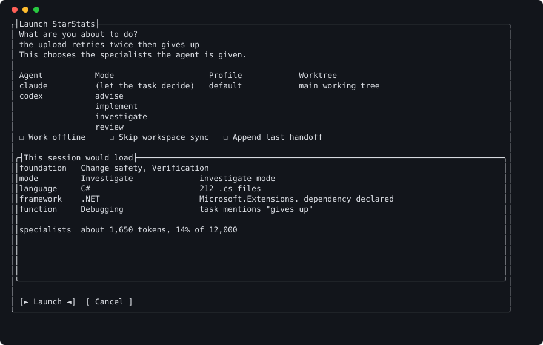

# Launching a session

**At the end:** a session started with the task and mode you chose, after
you've seen which instructions it gets and what they cost.

## Before you start

- A registered project. See [your first run](first-run.md).
- One sentence saying what you're about to do. "the upload retries twice then
  gives up" is a task; "work on the API" isn't, and won't reach anything the
  file extensions wouldn't have reached anyway.

## Steps

### 1. Open the launch sheet

Run `loadout`, move to your project and press Enter.

Enter doesn't start anything yet. It opens the launch sheet, with every question
already answered with the defaults. That one keystroke is what the preview
costs you.



You should see four choices — agent, task, mode, profile or worktree — and a
panel headed *This session would load*.

### 2. Pick the task

The top of the sheet lists the tasks the project has recorded: what's being
worked on, then what's open, then what's waiting. It opens on the newest one
you're working on, or on *No task* if there isn't one. A list, because a blank
line for a sentence gets skipped: across 122 launches it was typed twice.

- Pick a recorded task and the session is linked to it. Its title chooses the
  specialists, and its note is the first thing the agent reads.
- Pick *No task* for a session about nothing in particular.
- Pick *Other…* and press Enter to type a task that isn't recorded. Esc on an
  empty line takes you back to the list.

If you just want a session with the defaults and no task, press **Quick
session** and skip the rest.

### 3. Choose the mode

The mode holds for the whole session. Choose the one that matches what you're
doing:

- `implement` — you've decided what to do. This is the default.
- `investigate` — you want to find out why something happens.
- `review` — you want a change looked at.
- `advise` — you want a recommendation, not a change.

The mode is never guessed from your wording. That matters: ask for a bug to be
investigated in `implement` and the investigation guidance doesn't load at all,
which is the commonest reason a session doesn't behave as somebody expected.

### 4. Read what the session would load

As you pick the task or change the mode, the panel updates. You should see each
specialist it would load, why each was picked — "task mentions slow", "300 .cs
files" — and the total cost in tokens against the budget.

This isn't a separate preview. It's the resolver the launch itself uses, asked
early, so what it shows is what the session gets.

### 5. Launch

Press Enter on **Launch**. The agent starts with exactly what the panel showed.
Cancel instead and you're back at the list with nothing started.

## The same from the command line

Everything on the sheet is a flag:

```sh
loadout starstats --task "the upload retries twice then gives up" --mode investigate
```

A recorded task goes by its id, which `loadout task list` shows:

```sh
loadout starstats --task-id upload-retries --mode investigate
```

An open or blocked task moves to doing as the session starts, so the list says
what's being worked on without you declaring it as well. One already doing
stays where it is. An id the project doesn't have, or one that's dropped, stops
the launch rather than starting a session about nothing, and moves nothing. A
done task can have another session on it, and stays done: work often comes back
after it was called finished, and reopening it just to look again would record
it as unfinished when it may not be. The same happens however the session is
started: from here, from Studio's **Start**, or from **Work on its tasks…** in
the launcher's Project menu.

To see the whole launch described without starting anything:

```sh
loadout starstats --dry-run
```

Taken with Claude Code installed. Without an agent, the Agent line says none was found.

```text
$ loadout starstats --dry-run
warning Pre-commit protection: not installed in this clone; hooks are per-clone 
and never travel. Install it with: loadout protect
warning Dry run: nothing was launched.

What would run
  Agent        claude  C:\Users\example\.local\bin\claude.exe
  Directory    C:\Users\Public\example\src\starstats
  Mode         implement  chosen by the task
  Context      7.3 KB from 8 source(s), profile 'default'  
C:\Users\Public\example\AppData\Local\Loadout\runtime\20260923-005527-4402d292\c
ompiled-context.md
  MCP          
C:\Users\Public\example\AppData\Local\Loadout\runtime\20260923-005527-4402d292\l
oadout-mcp.json

Command
  C:\Users\example\.local\bin\claude.exe
    --mcp-config
    
C:\Users\Public\example\AppData\Local\Loadout\runtime\20260923-005527-4402d292\l
oadout-mcp.json
    --append-system-prompt-file
    
C:\Users\Public\example\AppData\Local\Loadout\runtime\20260923-005527-4402d292\c
ompiled-context.md
    --add-dir
    C:\Users\Public\example\AppData\Local\Loadout\workspace\projects\starstats
    --plugin-dir
    
C:\Users\Public\example\AppData\Local\Loadout\runtime\20260923-005527-4402d292\s
kills\loadout-starstats

Specialists
  + foundation.change-safety         always applies
  + foundation.engineering-core      always applies
  + foundation.evidence-first        always applies
  + foundation.forward-motion        always applies
  + foundation.verification          always applies
  + mode.implement                   implement mode
  + language.csharp                  required by framework.dotnet
  + framework.dotnet                 Microsoft.Extensions. dependency declared
  about 1,873 tokens, 16% of 12,000
```

You should see the executable, the working directory, the compiled context and
where it went, the environment variables by name, the full command line, and
every specialist with its reason. Nothing is started.

## Comparing two ways of asking

Before you launch, you can see what a different task or mode would change:

```sh
loadout instructions explain "why is this postgres query so slow" \
    --mode investigate --against-task "add a retry to the upload step"
```

Which specialists a task would load, why, and the token cost against the budget.

```text
$ loadout instructions explain "why is this postgres query so slow" --mode investigate --against-task "add a retry to the upload step"
- database.postgresql                   297  task mentions "postgres"
- function.database                     223  task mentions "query"
- function.performance                  217  task mentions "slow"
- function.debugging                    183  task mentions "why is"
+ function.distributed-systems          172  task mentions "retry"

  Unchanged  8
  Estimated  2,820 to 2,072 (-748)
```

You should see only the specialists that differ, the costliest first, and the
change in the total. [What you get](../features.md) has a full worked example.

## If it went wrong

- **The session didn't do what you expected.** Run
  `loadout instructions explain --project starstats "what you asked it to do"`
  first. Usually it never got the instruction you thought it had: the task
  didn't say enough, or the mode was wrong.
- **Launch is refused.** The detail pane and `loadout doctor` say why.

## What this doesn't do

- The token figure is an estimate of the instructions, not of the whole
  session. What the session then reads and writes is on top.
- It can't make a vague task specific. "work on the API" reaches nothing the
  file extensions wouldn't have reached anyway.

## Next

[Running a team](teams.md), when one session isn't enough.
