# Using Studio

**At the end:** Studio open in your browser, a session started and typed into
from it, a question from a team run answered, and Studio set up to look the way
you read best.

Studio is Loadout's front end in the browser, next to the classic dashboard.
The classic page is for watching runs. Studio is where you start sessions, work
in them, and see everything in flight at once. Studio is what the daemon's
address opens; both are served by the same daemon, at the same address, behind
the same sign-in.

## Before you start

- Loadout installed and a project registered. See [your first run](first-run.md).
- The daemon running, since it's what hosts Studio's sessions:
  `loadout daemon`. A dashboard started with `loadout dashboard` serves Studio's
  pages too, but can't host a session.
- A browser on the same machine. Studio only answers this machine.

## Steps

### 1. Open Studio signed in

```sh
loadout dashboard --open
```

You should see Studio's Home open in your browser. The command signs the
browser in with a cookie that lasts 90 days, so after this the address alone
works: `http://127.0.0.1:47611/studio/`, or whatever port the daemon is on.

A browser that isn't signed in sees one page, telling it to run that command.
There's no box to paste a token into, on purpose: the sign-in only ever comes
from a terminal on this machine.

To have the daemon's address open the classic page rather than Studio:

```sh
loadout config set dashboard classic
```

The classic page is at `/classic` either way, and
`loadout dashboard --open --classic` opens it signed in.

### 2. Find your way round

Down the left is the rail: Home, Sessions, Ideas, Teams, Events, Memory,
Context, Spend, Projects, Commands and Settings, each with a live count. Hover or tab onto it and
it widens over the page without pushing it. Below 600px wide it becomes a
**Pages** tab.

**Ctrl K** (or **Cmd K**) opens the palette from anywhere. It has three groups:
*Go to* a page, find what's *In flight*, and *Do* something. Every action shows
the exact `loadout` command it runs, so you can always do the same thing from a
terminal instead. Type two characters or more and pause, and it also searches
your tasks, ideas, sessions, team runs and projects, the same search as
`loadout find`, and lists what it finds under the three groups. Choosing one
takes you to where Studio shows it.

Along the top is the mode bar: the five modes, search, and whatever is waiting
on you. Everything here describes Default; [step 16](#16-change-the-whole-layout-with-a-mode)
covers the others.

### 3. Read Home

Home shows everything in flight: team runs, the sessions the daemon is hosting,
ideas being shaped and the tasks you're doing. It has two views, and **Lens**
and **Map** switch between them.

- **Lens** puts one piece of work in the halo, with *Needs you* beside it. A
  failure that wants acknowledging comes first, then the oldest question. The
  most urgent row lifts and the rest recede, and every state is a word and a
  glyph as well as a colour.
- **Map** draws every piece of work as a line through its stages, with *Needs
  you* as the interchange each one passes through. Pick a line and it's drawn
  straight below, with its checks, its last events and what you can do.

**Edit layout** lets you rearrange either view in place. Drag a panel by its
name or use its arrows, hide what you don't use, and **Add back** what you hid.
The layout is kept in Loadout's config (`studio-layout-lens` and
`studio-layout-map`), so it follows you to every browser.

### 4. Answer a question

When a team run stops to ask you something, it appears under *Needs you* with
its answers. A notification appears top right as well, and you can answer from
there. Each answer shows the command it runs:

```sh
loadout team gate <run> --gate <gate> --answer Approve --by dashboard
```

From the keyboard: **Ctrl K**, type a word from the answer, **Enter**.

### Look back at what needed you

**Events** keeps the last month of what needed you: each question a run asked
and how long it stayed open, a node that went quiet, a session left waiting, a
run that finished or failed. Answered ones are greyed, with *resolved 4m later*
beside them; one still open says so. **Go to it** opens the run or session it
happened in, which is where you answer, and marks it read. The rail counts what
is unread and needed you or went wrong.

The filters along the top (how much it wanted you, which way, how far back,
from what, the project and words in the title) go into the address, so a view
you use often can be bookmarked. *Which way* defaults to what was said to you;
**Done by you** shows your own answers, merge decisions and the sessions you
started. The same view in a terminal:

```sh
loadout events --filter "level=needs&since=1d"
```

The daemon records all of this while it runs, and only then. [Looking back at
what needed you](../teams.md#looking-back-at-what-needed-you) says what that
leaves out.

### 5. Start a session

Press **N**, or **New session…** on the Sessions page. The sheet asks
everything a launch asks:

- the project
- what you're about to do: *No task*, then the tasks the project has recorded
  as doing, open or blocked, then *Other…* for a one-off
- the mode
- the agent
- the profile and worktree, where there's more than one
- the switches `--offline`, `--no-sync` and `--handoff`

Under them, *This session would load* lists the specialists the session would
get and why, with their cost against your instruction budget (12,000 tokens
unless you've changed it). It's worked out by the same resolver as the
terminal's launch sheet and `--dry-run`. The command at the bottom is the
launch, and **Launch** runs it. **Quick session** starts one with no task and
the defaults.

You should see the session open with a live terminal filling the page. Type
into it as you would any terminal: Tab and the arrow keys go to the agent too.
To get the keyboard back out, press **Ctrl ]**, which moves to the **Details**
button. The bar above the screen says so while the terminal has the keyboard.

The bar also has **A−** and **A+** for the text size, and **Fit**, which
shrinks 80 columns to the width of the window. On a phone Fit starts on, and
zooming in scrolls inside the terminal rather than the page. **Details** folds
away the panel beside the terminal; below 960 pixels wide it sits underneath,
folded.

The bar under the screen says what the session needs, in words:

- **Waiting for you**: it has finished and wants your next message.
- **Needs approval**: it's asking to be allowed to do something. The choices
  are in the terminal, and you answer them there.
- **Waiting on background work**: it has stopped to wait on something of its
  own it left running, a test run, a subagent, a Monitor or a `/loop` wakeup,
  and will carry on by itself when that reports back. It's shown quietly, like
  idle, with no badge or sound, because it doesn't need you.
- **Ended**, **exited with an error** or **lost**, with the
  `loadout resume` command that carries the conversation on in a terminal.

Waiting and approval come only from Claude Code's own hooks, which Loadout
adds to a session Studio starts. Claude Code says it's waiting about a minute
after it finishes, and asks for approval a few seconds after the prompt
appears, so neither shows the instant it happens. Studio never guesses a
question from what's on the screen, and never puts an agent's choices on
buttons: it's told that a question is waiting, not what the choices are.
A Codex session shows only working, idle or unknown, because its own
notifications haven't been checked against OpenAI's documentation yet. The
question clears as soon as you type into the session. Clicking into the
terminal or scrolling back through it doesn't count as an answer.

Claude Code says it's idle a minute after every turn, including one that ended
on "I'll pick this up when the tests finish". So when it does, Loadout looks at
the end of the conversation's transcript for background work that hasn't
reported back. It keeps only the answer, yes or no, and when a wakeup is due;
nothing from the conversation itself is kept. The quiet state then lasts until
the wakeup's time, or until the work has been silent for 30 minutes, after
which it reads as **waiting for you** after all: a subagent that's gone quiet
for half an hour usually means something wants looking at. Work that was
already silent that long when Claude stopped doesn't count at all, because
that's far more often a server it started for you to look at than something
it's waiting on. A transcript Loadout can't read leaves the session as waiting
for you, which is the side to be wrong on. As soon as Claude carries on, typed
or not, the session goes back to working.

It was checked against real Claude Code transcripts as well as invented ones,
because the invented ones only test what was already expected: run over every
moment Claude went idle, it caught nearly every one where the agent really was
waiting on its own work, and the few it missed showed as waiting for you,
which is what they showed before. It's tied to how Claude Code writes its
transcripts, which can change; if it stops recognising them, sessions go back
to showing waiting for you rather than hiding anything.

With the mouse over the terminal, the wheel scrolls the terminal and never the
page. If the agent tracks the mouse, as Claude Code does, the wheel goes to
the agent, which scrolls its own view.

### 6. Leave and come back

The session belongs to the daemon, not the tab. Close the tab, reload, or open
the same session in a second window, and it's still there. Only one window
types at a time; another shows **Type here instead**.

Three things do end it: **End the session** on its page, which asks first;
**End session** on its tab in Terminals, which asks twice; and stopping or
restarting the daemon, which ends every session it hosts. `loadout daemon stop`
warns you when there are any. From a terminal, `loadout session end` does what
the tab does.

To carry a conversation on in a terminal instead, use the command the session
page shows. Once Claude Code has finished its first reply, that names the
conversation itself and its project; before then it's:

```sh
loadout resume --last --project <project>
```

A session that was running when the daemon stopped shows as **lost**, with the
same command, for a week afterwards.

### Pick an old conversation back up

**Sessions** has a **History** of every conversation from both agents, newest
first, whether Studio started it or you did in a terminal. Above it is the
search box the task board has, taking the query `loadout sessions --filter`
takes, such as `agent:codex project:alpha` or `fix sort:title`, over the newest
100. Like the board's, it's saved for next time. Each project's own page shows
its five most recent. Each row says what carries over if you resume it: the task, mode,
profile and worktree it was launched with.


**Resume** opens it in a new terminal here, running `loadout resume`, so it's
exactly what the same command does in a terminal. **Resume with changes…**
opens the launch sheet filled in with what would carry over. What's in the
sheet when you press Resume is the whole of what it reopens with, so choosing
no task or the main checkout there means that.

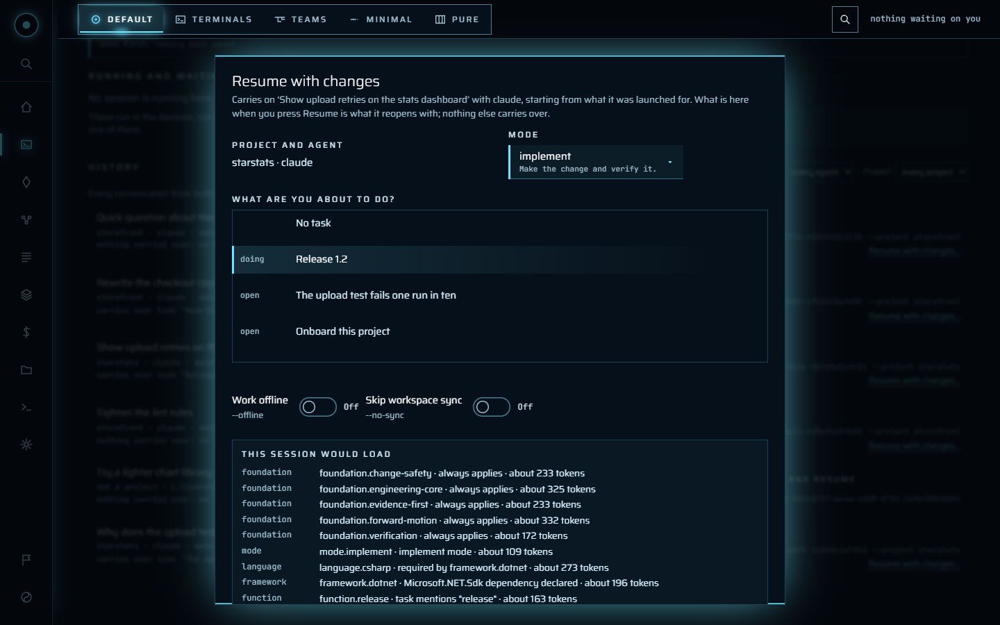

Only a conversation whose launch is on record carries anything over. Loadout
files each Claude Code conversation it launches under that launch as it starts,
and older conversations, ones you started outside Loadout, and Codex ones say
**nothing carried over** rather than having a guess made for them. A guess is
what resume used to do, and when two sessions overlapped it gave one the
other's task.

A few things are asked before anything starts:

- **Already open in Studio**: the row says **Open** and takes you to its
  terminal rather than starting a second copy.
- **Looks to be running elsewhere**: its launch is still going, or it was
  written to in the last five minutes. Studio asks before resuming it, because
  a second copy writes to the same conversation without seeing the first's
  turns.
- **Not a project**: a conversation from a folder Loadout doesn't know offers
  **Register and resume**. It names the folder first, then registers it as
  `loadout project add` would. It can only ever register the folder that
  conversation ran in. The conversation carries on as itself rather than
  becoming the new project's onboarding; the terminal reminds you the project
  still has that to do.

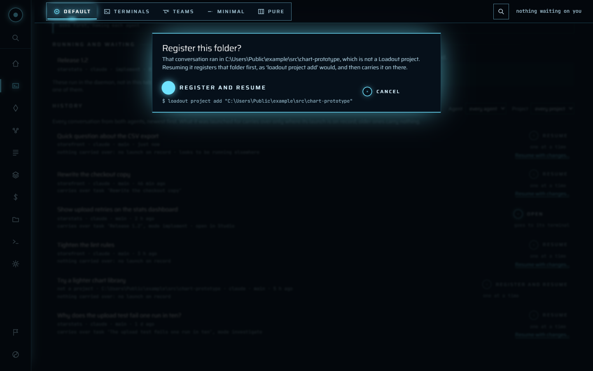

A team node's conversation isn't in the history. Take one over from its run's
page, where you can see what it was doing.

When the daemon restarts, the sessions it was hosting end with it. The next
time you open Sessions, a panel lists the ones you can carry on, each with
**Resume** and **Not this one**. **Resume all** says how many agents it will
start, and which ones, before it starts any. Nothing restarts by itself,
because each one starts an agent, and an agent costs money. You may not want
them all back. A session that ended before its agent's first reply isn't
offered, because there was nothing to carry on.

### 7. Make it yours

**Settings → Appearance** has four themes, four accents, three densities and
three levels of motion. The themes are Dark, Light, High contrast dark and High
contrast light; with no theme set, Studio follows your system's colour scheme
and contrast. If your system asks for reduced motion, that always wins, whatever
you choose here.

They're kept in Loadout's config, not the browser:

```sh
loadout config set studio-theme hc-dark
loadout config set studio-accent violet
loadout config set studio-density roomy
loadout config set studio-motion reduced
loadout config set studio-halo gyroscope
loadout config set studio-idle-after 20
loadout config set studio-background-limit 60
```

The things kept in the browser are the single-letter shortcuts (**A** for
Ambient, **N** for a new session), whether Ambient fills the screen, and the
mode with what each mode remembers. They're about the keyboard and screen in
front of you, not about how you read, so a phone can stay in Minimal while a
desktop stays in Terminals.

**Settings** has more than Studio's own, in sections listed down the left.
**Loadout's settings** lists every setting `loadout config` knows, in the same
groups the terminal's Settings screen uses. Type in the box to find one by name
or by what it does, and the groups with a match open. Each is changed where
it's shown: edit it and **Set it** runs `loadout config set`, **Put it back**
undoes your edit, **Clear it** puts a set value back to its default, and
**Explain it** shows what `loadout config get --explain` says about it.

**Agents and packs** covers the MCP servers every project loads, secrets
(checked and removed here; stored only in a terminal, at a masked prompt) and
specialist packs, each marked approved here or not. **Backups and safety**
covers backups, checkpoints and keeping AI files out of repositories. **The
daemon** says whether it's running, whether its schedules are held and whether
it starts when you log in, with a button for each of those. Restarting or
stopping it asks first, because it ends the sessions the daemon hosts. **This
machine** shows what `loadout doctor` finds, worst first.

What is only ever done in a terminal has a block saying what to type and why,
with **Copy**, and never a button: setting a secret, the attach passphrase,
agreeing to a tool's tests, and the telemetry receiver on Spend. Copy copies the
line and runs nothing.

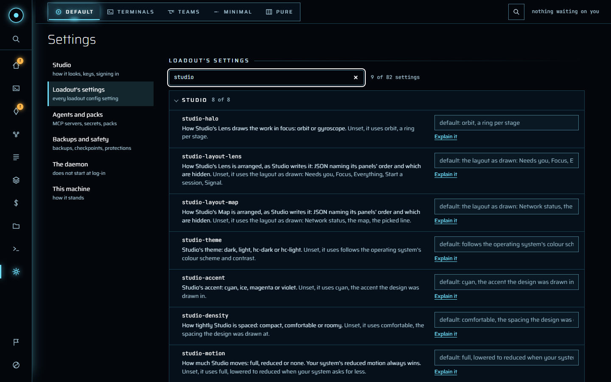

### 8. Keep what a project remembers

**Memory** is three columns. On the left is what a project remembers, by store:
this project's, yours across every project, and this machine's, which is
read-only here, each topic with how many facts it holds. In the middle is the
topic you chose, to read as stored and edit in place. On the right is what the
memory audit makes of the project, a search, and the tools.

A save carries the version you read, and **Save** shows the command it stands
for: `loadout memory replace <topic> --project <slug> --file <path> --expect
<version>`. If somebody else changed the topic meanwhile, nothing is saved: you
see what's on disk now beside your edit, with the lines only on disk marked, and
choose **Keep my edit, then save** or **Take theirs**. One never overwrites the
other.

The tools record a fact, rebuild the index, clean up what the audit found,
bring in what the agent recorded outside the workspace, move durable facts out
of always-loaded instructions, and walk the topics nobody has revisited.
Cleaning, importing and compressing only report what they would do until you
tick `--apply`. A project topic can be deleted too; a backup is taken first.

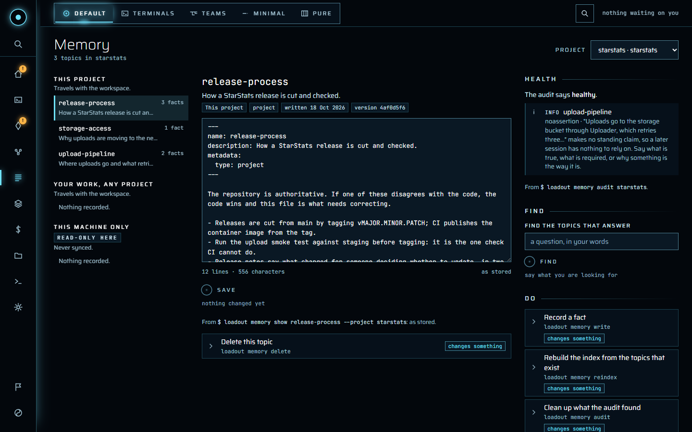

### 9. See what it's costing

**Spend** reads the agents' own transcripts and leads with one number: what
was billed as input once the cache had done its work, and how much the cache
saved. Under it, one bar splits the period four ways (input, read from the
cache, output and thinking), each with its own pattern as well as its colour.
Choose the day, week, 30 or 90 days at the top. Reading a long history takes a
while, up to a minute or so, and the page says it's reading meanwhile.

**Where it went** shows the twenty largest by project, model or agent, and says
how many smaller ones were left out; a folder that isn't a registered project
says so. By day, it's a chart you read by hovering or with the arrow keys.
There are no budgets on this page: budgets belong to team runs.

Beside that are the sessions running now, then what was launched this week and
how many tokens each started with, the recent sessions, what launched agents
reported about themselves when the receiver was running, and a summary of this
machine. The rail's Spend says what the last 30 days cost, once you've opened
the page.

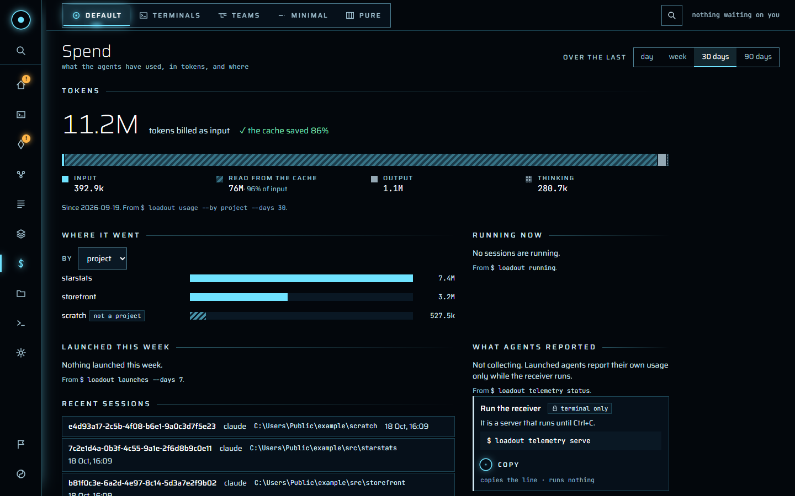

### 10. See what a session will be told

**Context** shows, for one project, what a session would load before it starts.
Choose the project at the top, type the task in a sentence and choose a mode,
and **Explain it** draws one bar: a segment for each specialist it would load,
against a mark for your token budget, with the total and whether it's within,
near or over it. Under the bar, each specialist says why it's loaded and what
it costs; the ones loaded for every session are hatched. Point at a segment and
its row lights, and the other way round. Any specialist opens to show what it
says and when it loads.

The other sections, along the tabs, cover the specialists themselves, the
project's path-scoped rules and coding styles (the one in force says so), its
profiles, whether its documents still describe the repository, and whether the
project departs from what its specialists ask. Each has its actions below it:
splitting an oversized instruction file into rules, choosing a coding style,
drafting or copying a specialist, finding where a type is declared, and writing a
handoff for the next session.

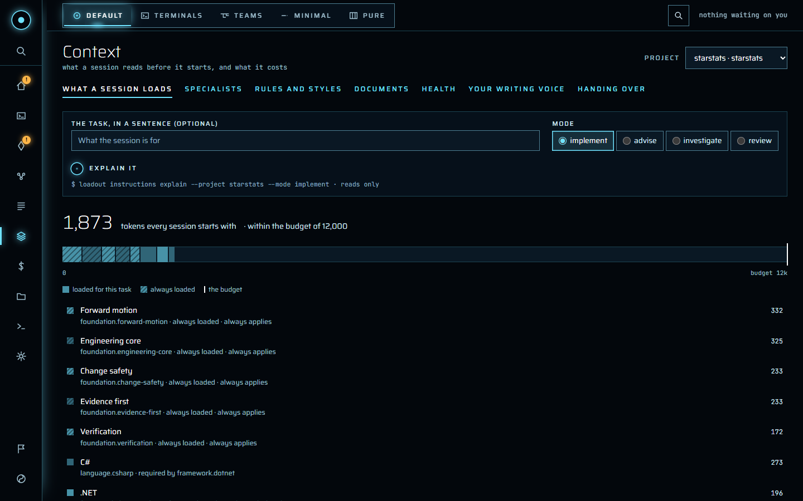

**Your writing voice** shows the voice learned from your own writing and the
rules in force, checks a message or a file against it, and renders it into the
style specialist your sessions load. Learning a voice asks you about each rule
as it goes, so it opens in a terminal here.

### 11. Steer a team run

**Teams** opens on everything a run wants of you, under **Needs you**. A run
lands there when it asks something, when its lead takes a round without asking
for anything, when a node goes quiet for three times its usual turn, or when its
budget is spent or projected to be. Each reason clears itself: nothing is
dismissed by hand. A question is answered where it's shown, and each kind has
its own answers:

- **The lead's question**: its options, the one it recommends drawn solid, and
  **Think again**, which sends it back to the lead.
- **Its readings** of your done-when, before any worker starts: accept them, or
  send them back.
- **A brief**, in a manual run: in a box you can change before it goes. Change
  it and the button says **Send your brief**, and the command gains
  `--instead`.
- **The proposed done-when**: one criterion per line, in a box.
- **A confirmation or a permission**: yes or no.
- **Its budget**: raise it, take the cap off, or type a figure.

Under each answer is the `loadout team gate` command it runs.

Below that are the runs going, each with **Hold after this round**, **Let it
carry on** and **Stop after this round**, and the ones that ended, with **Run it
again** (which opens Start a run filled in, and starts nothing), **Pick it up
where it stopped** and **Forget it**. Above both is the task board's search
box, taking the query `loadout team runs --filter` takes, such as
`team:release-crew cost:>2 sort:-cost`. It narrows those two lists and never
**Needs you**, because something waiting on you shouldn't be hidden by a
filter you set last week. Then the teams you can run, and the runs on a
schedule, with whether the daemon will fire them.

**Start a run**, **Make a team** and **Run one on a schedule** open a sheet that
writes its command under the form as you fill it in. Start a run asks once more,
naming the team and the goal, because it spends money and edits a project. A
schedule can't be manual, and can't repeat faster than every five minutes.

Choose a run to open its page: its shape (the lead's line, with the nodes each
round briefed hanging from it), what it will be judged on, who is on it, its
spend, a box to say something to the lead, and what you can do to it. Below
are five depths, on keys **1** to **5**:

1. **What it said**: the journal as it's written, or one node's stream.
   Typing at a live node needs the attach passphrase as well as your sign-in;
   it's swapped for a grant that lasts 30 minutes and lives only in the page.
2. **What it cost**: what it's costing, where that's projected to end, where
   the time went and what went wrong.
3. **The papers**: each brief beside the report it got back.
4. **What it changed**: each node's patch, with **Open a pull request**. That
   asks first, and offers **Say what it would do**, which runs it with
   `--dry-run`.
5. **What it delivered**: the run's files in a tree, by node and commit or by
   folder, beside a viewer that shows Markdown rendered, code with line
   numbers, a CSV as a table and an image as itself. **The change** shows the
   file's part of its node's patch. **Download**, **Download all** and **Copy
   path** read only, so they show no command; each file shows the terminal line
   that reads it instead. Lines that look like credentials are taken out before
   a file is shown, and you're told how many.

A team's page has its nodes, what a run of it follows, its runs here, and how
its roles have been doing, read only when you open it. **The bin** puts runs and
teams back, empties for good after naming what goes, and clears out old runs,
saying which as a sentence first. **Remedies** answers a remedy's requests;
trusting a remedy is a standing agreement, so the page shows the command for a
terminal instead. So does setting or clearing the attach passphrase, since the
page can't set the passphrase that guards it. Naming a run's room stays on the
classic dashboard, which is the one that draws the office.

### 12. Shape an idea

**Ideas** is a shelf of every idea being shaped, by project, beside a workbench
for the one you chose. The shelf has the same search box, taking
`loadout idea list --filter`'s query, such as `stage:answering unanswered:>0`. The workbench shows where the idea stands (captured,
answering, ready, proposed or accepted), what the agent understood, and, if its
last round failed, why, with **Try the round again** and **Clear the marker**.

Answer its questions in the page: pick one of the agent's options or say it in
your own words, then **Send answers and refine** to have an agent take it one
round further, or **Only save the answers** to come back to it. Each answer is
its own `loadout idea answer`, listed before you send. A round runs on the
daemon, so you can leave the page; a toast says when it's finished.

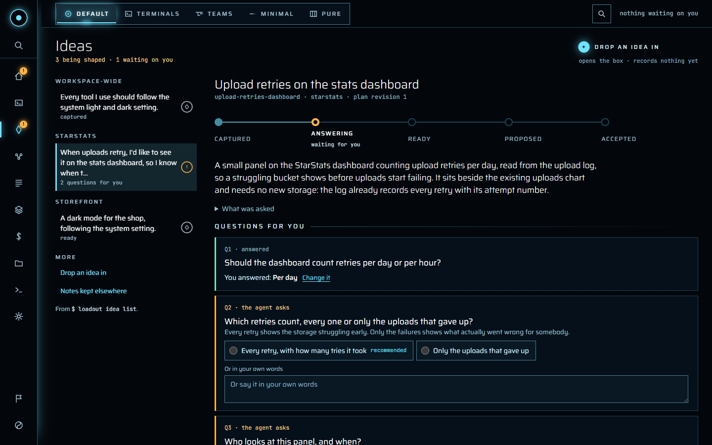

Once there's a plan, each layer shows its options side by side with what's for
and against them. **Choose this**, **Keep it** and **Drop it** each run the
command shown under them, and a layer, an addition or the whole plan can be sent
back with a sentence saying what should change. **Accept the plan** puts it onto
a project, or makes a new one for it, and says if any layer still has no option
chosen.

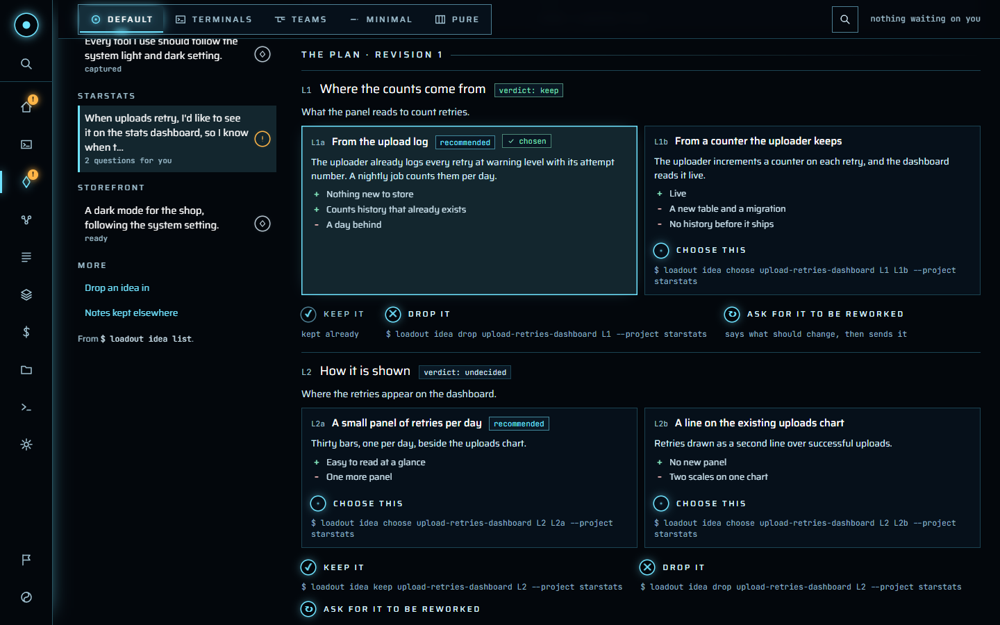

An idea moved from another list says where from. One that became a task on
another project, by accepting it or moving it later, is listed under **Became
tasks elsewhere** with a link to it, so an accepted idea doesn't just vanish
from the shelf. An accepted idea's workbench links to the board its task is on,
and that task's **Details and history** links back to the idea, worked out
from the id the two share.

Dropped ideas fold away under a count at the foot of the shelf, as done and
dropped tasks do on a board. The shelf reads up to 200 ideas, the newest
first, and says so if there are more; narrow it with the search box, or read
them all a page at a time with `loadout idea list --limit`.

**Notes kept elsewhere** takes notes you've pasted from somewhere else and has an
agent split them into ideas and tasks. Nothing is recorded until you apply the
pieces.

### 13. Look after your projects

**Projects** is a wall of tiles, one for each project Loadout knows, with what
matters at a glance: tasks under way and blocked, what can be put right, and
ideas. A search box above the wall takes the query `loadout list --filter`
takes, such as `where:here agent:codex`, and is saved like the board's. Choose
one and it opens underneath: where it is, its branch, remote,
agent and how often it's been launched, its working trees, and its health:
where it has drifted from what was recorded, and whether any AI tooling files
are tracked in the repository.

**What is being worked on** is a board of its tasks in three columns, open,
doing and blocked. Above it is a search box that takes the same query as
`loadout task list --filter`, such as `state:doing login sort:-updated`, with
each piece of the query shown as a chip you can remove, a menu to add a filter
and one to choose the order. Press `/` to get to the box. Done and dropped
work is hidden to start with, by the filter `-state:done,dropped`, which shows
as a chip like any other: remove it, or press **Show all**, and they come back
folded under the columns. **Reset to default** puts the filter back. The filter
is saved for the list, so it's the one the board opens with next time, and the
one `loadout task list` starts from. A query
the launcher can't read is refused beside the box, in the same words the
terminal uses, and the board stays as it was. Each
task is moved on with one press (mark it doing, say it's blocked, mark it done,
reopen it, drop it), and a new one is recorded under the board. **Start**
launches a session on the task, the same as `loadout launch <project> --task-id
<id>`, and opens it; an open or blocked task moves to doing once the session
has started, and one already doing or done stays where it is. A launch that
fails moves nothing. **Start with options…** opens the launch sheet with the
task already chosen, for a different agent, mode or working tree. Every task
but a dropped one can be started. A task moved
here says where it came from, and one moved away is listed under **Moved
away** with a link to where it is now, apart from the columns and counted in
none of them.

A card is kept to its title, two lines at most, and a line about it, so a
column stays readable however much was written about a task. **History**, or
**Details and history** when there's a full description, opens the task in
full: its detail, its note, and every change of state with who said so and
when, the same as `loadout task show <id>`. A task recorded before there was a
history shows only its latest claim, and says so. The dialog puts the task in the page's address,
so a reload reopens it and the address can be shared on this machine, even
for a task on a later page of a board.

**Every task, across projects**, linked under the wall, is one board of every
project's list and the workspace-wide one, the same as `loadout task list
--every-list`. Each card names its project, and its moves and **Start** are on
that project's list. Narrow it with `project:` and a slug, or `project:global`.
It's read 50 tasks at a time, with **Previous page** and **Next page** at the
foot, and goes back to the first page if the one you were on has gone. Open
work fills the first pages, so a column with nothing in it says *None on this
page*: what's doing or blocked may be on the next. Its
query isn't saved, because a filter naming one project would empty every
other project's board.

Below the board is
everything else you can do to it, each folded until you open it: open it in the
editor or its folder, onboard it, change what every session gets, relocate it,
link it. Each shows the command it runs, and what's shown is read again once it
finishes.

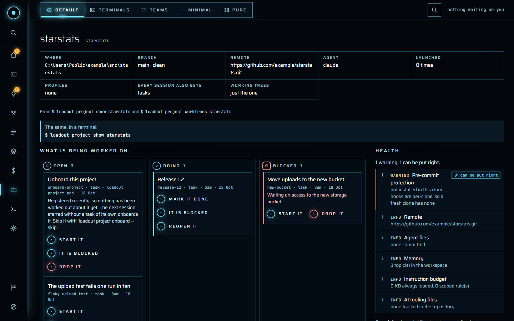

**Forget project…** opens a dialog. Forgetting it on this machine only means
Loadout forgets where it is here; it stays in the workspace for your other
machines. Forgetting it from the workspace means every machine forgets it, and
its tasks, ideas and memory topics can go with it, each removed by its own
command, listed in order before anything runs. **Preview** runs them all with
`--dry-run`, and forgetting it on every machine needs a second press within
five seconds. The project's folder of instructions, rules and memory stays in
the workspace whatever you choose, because no command deletes it; the dialog
says where it is. The repository and its code are never touched.

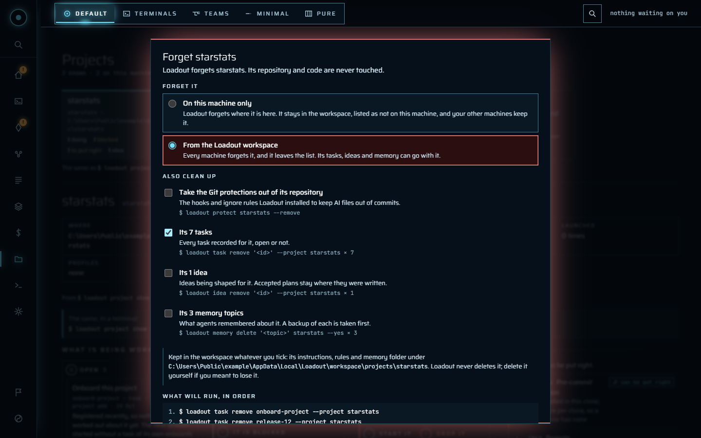

The tiles at the end of the wall add a repository you have, make a new project,
or find repositories and stray memory. Under the wall are tasks that belong to
no project yet, and the workspace, where you can bring in what other machines
saved and save and push what changed here.

### 14. Run anything else from Commands

**Commands** lists every command Loadout has, folded by area. Choose one and
Studio builds a form from the command's own options, so it can't offer one the
command doesn't take, and shows the line it'll run as you fill it in. **Run**
runs exactly that line on the daemon; **Preview** adds `--dry-run` for a command
that changes something. What it printed comes back on the page, with any secret
taken out, and a toast says when it's finished.

It's how you reach the parts of Loadout that don't have a page of their own yet.
Each command runs from your home folder, so a command that picks its project
from the folder you're in needs `--project`. It's never asked a question: a
command that would ask one is refused instead, and says so.

A command that asks as it goes, such as `setup`, `voice learn`, `memory review`
or `resume`, can't be run that way, because nobody could answer it. Its form has
**Open it in a terminal** instead, which runs it in a terminal the daemon hosts
and takes you there, where you answer it as you would in your own.

A few commands only ever show their line, with why: setting a secret (it asks
for the value at a masked prompt), the attach passphrase, trusting a tool or a
remedy, `update`, and the commands that are themselves a server or a status
line. Starting a session sends you to **Sessions**, where Studio hosts it.

### 15. Ambient

On Home, **A** or **Ambient** turns Studio into something for a spare screen:
the key numbers, the halo on whatever most needs you, and everything else
circling it. **Escape** or **Leave ambient** leaves it.

### 16. Change the whole layout with a mode

The mode bar at the top of every page has five modes, and **Ctrl Shift M**
moves to the next from anywhere, a terminal included. The palette lists each
one as *Mode: Terminals* and so on. The mode is kept in this browser, not in
Loadout's config.

- **Default** is Studio as the rest of this guide describes it.
- **Terminals** turns Home, Sessions and a session's page into one deck: every
  hosted session a tab, over one, two or four live panes. **Ctrl Alt 1** to
  **9** picks a session by its tab, and **Ctrl Alt** with the arrows moves
  between the panes shown. Panes stay where they are: clicking into one only
  moves the highlight and the keyboard, and a session you pick from its tab
  takes the highlighted pane without moving the others. A session that ends
  stays in its pane until you pick something else, and one that's gone from
  Studio altogether says so. Hiding or clearing a tab is different: you took
  it away, so its pane goes to the next tab along. A dot on a tab means output since you looked. **Go
  to the one waiting** appears when a session needs you, and *Find in this
  terminal* searches the one you're in, highlighting matches in the needs
  colour. With two or four panes, drag the divider between them to give one
  more room. Four stay a grid: one divider runs the full height and one the
  full width, so **Ctrl Alt** with the arrows still goes where you'd expect.
  A pane never gets narrower than about 40 columns or shorter than about 8
  rows, because an agent squeezed below that can't draw its screen. While you
  drag, the panes follow the mouse but the session is only told its new size
  when you let go or stop for a moment, so a full-screen agent redraws once
  rather than on every pixel. A divider takes the keyboard too: the arrows
  move it, **Shift** with them further, and **Enter** or a double click puts
  it back in the middle. Below 900px it's one pane and the tabs. The
  layout, where the dividers are (one set for two panes and another for four),
  which session is in each pane and the last session you picked are
  remembered in this browser.
- **Teams** turns Home and the Teams page into a board: each run one row with
  its goal, a small line of its rounds and nodes, its state and its spend, the
  one that needs you first, with its question answered in the row. The teams
  run along the top. Picking a run or a team opens its page beside the board;
  below 1100px it replaces the board, and **Close** goes back. Remedies, the
  bin, shared tools and the webhook stay on the Teams page in Default.
- **Minimal** is one quiet column of what's live, sessions and runs together,
  what needs you first with its question under it. Opening one gives it the
  screen: a session as just its terminal, a run as just its question, its shape
  and its done-when. **Escape** or **Back** gives the column back. The rail
  slides away; the mode bar stays.
- **Pure** is [step 17](#17-pure-focus).

Ideas, Projects, Context, Settings, Memory and Spend follow the mode too, at
the same addresses:

- In **Terminals** and **Teams** they open beside the terminals or the board,
  which stay live: you can still type into a session or answer a run while a
  page is open. **Close** or **Escape** goes back to where you were, but Escape
  is left alone while you're typing in a field or a terminal, or in a dialog.
  Drag the divider between them to give the page or the terminals more room;
  the page keeps at least the width it always had. Below 1100px the page
  takes the width and the divider goes. Opening or closing a page beside the
  terminals never reconnects them, so their scrollback stays.

  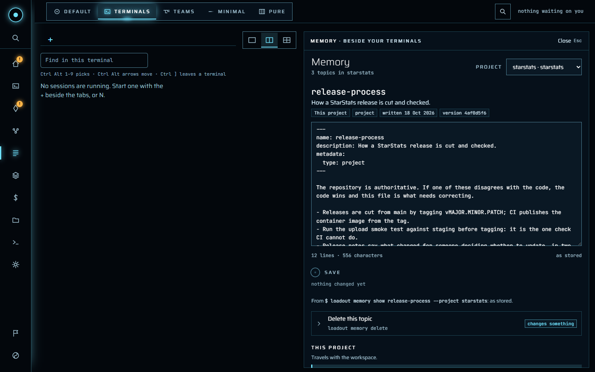
- In **Minimal** each is one quiet column: a sentence on how things stand, with
  what needs you in bold, then what needs you or has gone wrong, then **Show
  everything** for the page as it is in Default. Opening an item fills the
  screen with just that: an idea's workbench, a blocked task, a section of
  Settings, a topic. **Escape** gives the column back. A link to a page opens
  with everything shown.

  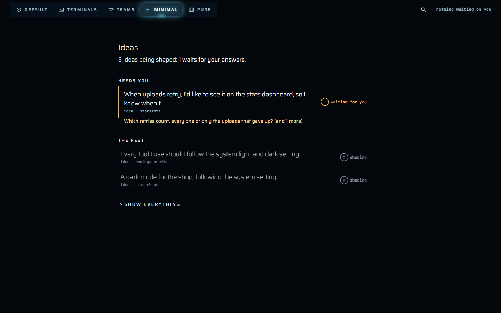
- In **Pure** each is a desk of its own, described below.

Whatever the mode, the count on the right of the mode bar is everything waiting
on you, sessions and runs together, and pressing it goes to the oldest question
wherever that mode shows it. No mode hides a question.

Changing mode is one animated step where your browser can do it, a short fade
under reduced motion, and simply happens under none.

Each pane in Terminals is its own connection to the session. A pane you stop
showing closes its connection; show it again and the daemon replays what the
session has written, so nothing is missed. Typing goes only to the pane that
has the keyboard, and **Ctrl ]** gives the keyboard back to its tab.

The tabs themselves can be closed, renamed and moved. Each has a **×**, and a
menu on right-click, the context-menu key or **Shift F10**.

- **Closing** an ended tab clears it at once. Closing a running one asks
  whether to **Hide** the tab or **End session**. Hiding leaves the session
  running and still on the Sessions page; the count at the end of the strip,
  or **Open in Terminals** on the Sessions page, brings it back. Ending asks a
  second time, naming the session and its project, because it's the one thing
  here you can't undo. An ended session stays listed, so you can see how it
  ended. **Delete** closes the tab you're on.
- **Renaming** happens in the tab: **F2**, type, **Enter** to keep it,
  **Escape** to leave it. Emptied, it goes back to the name it was launched
  with, and the menu offers that too. The name is held by the daemon, so every
  browser and `loadout session list` show it. Claude Code is given it as well,
  through its own `/rename`, so a resumed conversation carries the same name.
  Loadout types that only while Claude is waiting for you, never into a reply
  it's writing, and it shows in the terminal when it does. An agent that has
  no such command keeps the name in Loadout only, and the rename box says so.
- **Moving** is by dragging a tab along the strip, or **Ctrl Shift** with the
  arrows. **Ctrl Alt 1** to **9** follow the order you set.

The order, what you hid and what you cleared belong to this browser, so
arranging tabs here never changes what another screen shows. Only a name or
an end reaches the daemon. A Studio that's only watching can move, hide and
clear tabs, but can't rename or end a session.

### 17. Pure Focus

Pure Focus is for acting fast, with the keyboard or the mouse. It's flat: no
glow, nothing that breathes or pulses, 1px edges, in your own theme and accent.
The only movement is a brief flash on what you ran.

Home, Sessions, a session, Teams and a run all become one desk of three panes
over a command bar:

- **List**, on the left: what needs you, then sessions, team runs, ideas and
  tasks.
- **View**, in the middle: the thing you picked. A session is its terminal; a
  run is its question, its shape, its done-when and its crew; an idea or a task
  is its facts and latest events.
- **Actions**, on the right: up to nine, numbered, each with the command it
  runs. They're the same actions, with the same commands, as anywhere else.

Drag the dividers between the panes to change how wide each is. The list and
the actions keep the widths they always had at the least, and the view never
gets too narrow for a terminal. Below 1024px the actions move under the
other two and the dividers go.

Every key is printed beside what it does, and **?** lists them all:

| Key | Does |
|---|---|
| **J**, **K**, or the arrows on the list | move the selection |
| **Home**, **End** | first, last |
| **Enter** | open what's picked in the view |
| **Escape** | back to the list; keeps an armed action |
| **1** to **9** | run that action |
| **/** | filter the list |
| **:** | open the command bar |
| **G** then **H**, **S**, **T**, **K** or **N** | the list: everything, sessions, team runs, tasks, what needs you |
| **G** then **I**, **P**, **C**, **M**, **U** or **O** | a page's desk: Ideas, Projects, Context, Memory, Spend (usage), Settings (options) |
| **F6**, **Shift F6** | the next or previous pane |
| On a divider: the arrows, **Shift** with them, **Home**, **End**, **Enter** | move it, further, as far as it goes, back where it was |
| **?** | every key |

The filter has no fields, because the list holds every kind of thing at once,
so it takes only the words of the query the other lists take: every word has
to be in the title or the facts beside it, `"a phrase"` is looked for whole,
and `-draft` leaves out what has it. The Outbox's **Find a file** works the
same way over each file's path and the node that delivered it.

Single keys work only when you're not typing. In a terminal every key goes to
the agent, and **Ctrl ]** brings you back to the list. With single-letter
shortcuts off, only **Escape** and the list's own arrows, **Home**, **End** and
**Enter** work; **F6**, the buttons and the command bar still do.

An action that can't be undone, such as **Stop after this round** or **End the
session**, asks for its number twice. The first press says *Press 5 again to
stop after this round* for three seconds, and **Escape** keeps it. There's no
dialog, which is deliberate: a dialog would take the keyboard away from the
desk.

The command bar finds the picked thing's actions, places and things, and every
command in Studio's catalogue, each showing what it runs before you press
**Enter**. A command opens its form on the Commands page, in Default.

The scope and the last thing you picked are remembered. A team's page, the
remedies and the bin aren't part of the desk; they open as pages, in the flat
look.

**G** then a letter opens one of the six pages as a desk of its own: **I**
Ideas, **P** Projects, **C** Context, **M** Memory, **U** Spend (for usage) and
**O** Settings (for options). The list is what the page holds: ideas with what
needs you first, projects on this machine and then elsewhere, Context's sections
and specialists, Settings' sections, a project's topics by store, or Spend's
blocks. The view is the page itself, laid out to fit. The actions are the
page's own: refining or accepting an idea, opening, onboarding or forgetting a
project, explaining what an implement, advise, investigate or review session
would load, holding or
restarting the daemon, rebuilding a project's memory index, changing Spend's
period. The command bar has a row for each desk too. Adding a repository,
dropping an idea in and the other places still open as pages.

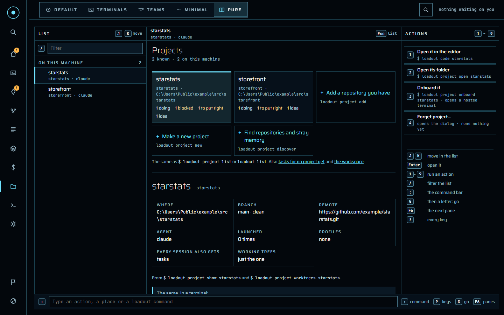

## Watching only

```sh
loadout dashboard --watch-only
```

Studio still shows everything, but changes nothing. A banner says so, and every
action shows the command to type in a terminal instead. Launching, typing into a
session, ending one and changing a setting are all refused by the server as
well as the page. On **Commands**, only commands that just read run, and
**Preview** still works for the rest.

## What it won't do

- **Read a secret back, or make an agreement for you.** The team attach
  passphrase and a tool's test agreement are set in a terminal. Settings shows
  the commands, never a button.
- **Reach another machine.** Studio answers loopback only, and checks that every
  change comes from its own page.
- **Write terminal output to the daemon's log.** What an agent prints stays in
  the session.

## If something goes wrong

- **"This browser isn't signed in to Studio"** — run `loadout dashboard --open`
  again. Somebody may have signed every browser out
  (`loadout dashboard sign-out`, or **Sign out every browser** in Settings).
- **"Only the daemon hosts sessions"** — you opened Studio from
  `loadout dashboard`. Start the daemon with `loadout daemon` and open its
  address instead.
- **A session has gone** — the daemon restarted. Sessions don't survive that;
  `loadout resume --last` carries the conversation on in a terminal.
- **Anything else** — **Report a problem**, at the foot of the rail, opens
  Studio's bug form on GitHub with the version and platform filled in. It sends
  nothing on its own; paste `loadout doctor` into the form if you can.
